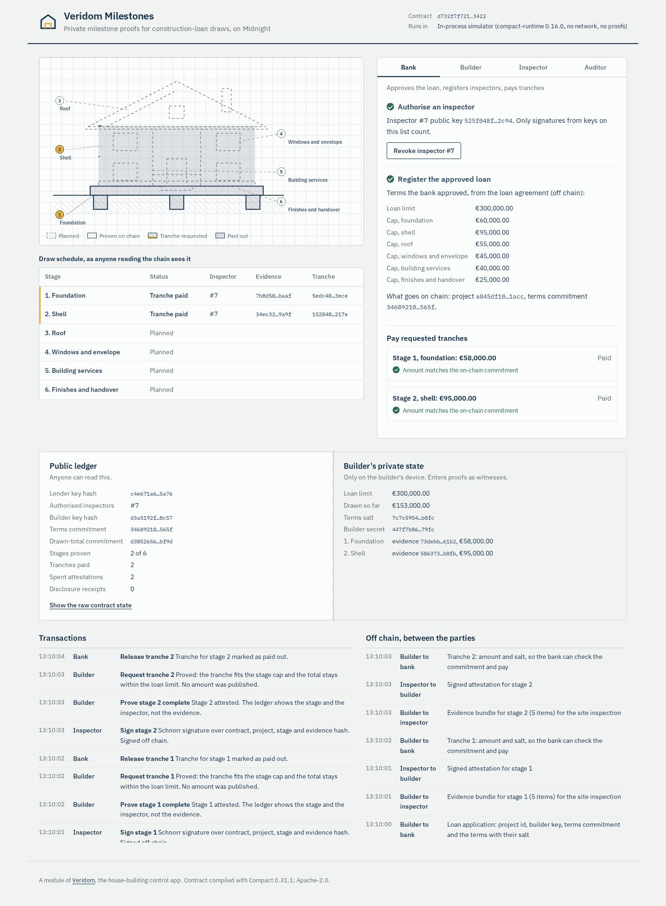
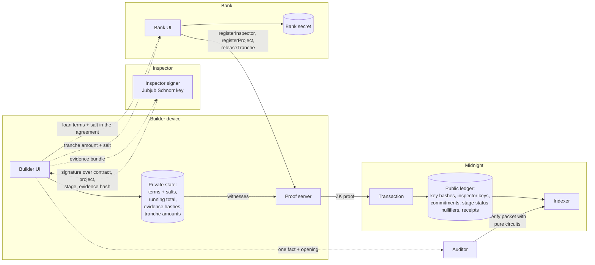

# Veridom Milestones

**Private milestone proofs for construction-loan draws, on Midnight.**

A bank pays a construction loan in tranches, one per finished stage of the build: foundation, shell,
roof and so on. Today the builder hands over everything for every tranche: site photos, invoices,
contractor names, amounts, personal data. Copies of it end up in the bank's systems and with the
bank's surveyors.

Veridom Milestones replaces that hand-over with proofs. A Compact contract on Midnight shows, on a public
ledger, that

- **stage _k_ is complete**: an inspector the bank authorised signed the evidence bundle for exactly this
  project, this stage and this contract;
- **the cumulative draw stays within the approved loan limit** and each tranche within its stage cap;

while the evidence, the amounts, the contractors and the builder's identity stay on the builder's device.
When an auditor needs one fact, the builder opens exactly that fact, with consent recorded on chain.

Veridom Milestones is a new module of [Veridom](https://veridom.space), a live house-building control app that
tracks a private home build against the approved plans with a diary, photos and inspections.

| | |
| --- | --- |
| Contract | [`contract/src/veridom-milestones.compact`](contract/src/veridom-milestones.compact), 8 provable circuits, 8 pure circuits |
| Toolchain | `compact` 0.5.3, compiler **0.31.1**, language 0.23, compact-runtime 0.16.0, midnight-js 4.1.1 (the [support matrix](https://docs.midnight.network/relnotes/support-matrix) for Preview, Preprod and Mainnet) |
| Compile record | [`contract/build-evidence/compile.log`](contract/build-evidence/compile.log) |
| Tests | 50 simulator tests (`npm test`), 5 end-to-end tests with real ZK proofs on a local devnet (`npm run test:e2e`), a browser flow test (`npm run test:ui`) |
| Devnet run record | [`contract/build-evidence/local-devnet-run.log`](contract/build-evidence/local-devnet-run.log): 9 proven transactions, tx ids and blocks |
| Frontend | React + TypeScript, runs the contract in the browser (simulator) or through the Lace wallet |
| Pitch | [slide deck (PDF)](docs/slides/veridom-milestones-deck.pdf) ([HTML source](docs/slides/deck.html)), [demo video script](docs/demo-script.md) |
| Demo video | _link added before submission_ |
| License | [Apache-2.0](LICENSE); third-party attribution in [NOTICE](NOTICE) |



---

## What we built this wave

This is our first Midnight Buildathon submission (wave 3). Everything in this repository was written during
the wave.

- **Compact contract** with lender and builder roles derived from witness secrets, an inspector registry, a
  commitment to the loan terms, in-circuit Schnorr verification of inspector attestations, spent-signature
  nullifiers, a private running total kept as a commitment and updated through write-back witnesses, stage-cap
  and loan-limit checks over private values, and salted selective-disclosure receipts.
- **Simulator test suite**: 50 tests, including every negative case we could name: tranche over the limit,
  tranche over the stage cap, unauthorised, rogue and revoked inspectors, evidence swapped after signing, a
  replayed attestation (same stage, other stage, other project, other contract), disclosure without consent,
  a tampered disclosure packet, a forged Schnorr challenge reduction, and a scan of the full public state for
  any private value.
- **End-to-end run on a local Midnight devnet** (node 1.0.400, indexer 4.3.5, proof server 8.1.3): deploy plus 8
  circuit calls with real ZK proofs, state read back from the indexer, an auditor packet verified against it.
- **Frontend** with four roles, a dual view of the public ledger and the builder's private state, and a log of
  what moves on chain next to what moves off chain. It runs fully in the browser now, and is wired for Lace.
- **Pitch material**: slide deck and a demo video script.

Next wave: deployment on Preprod through Lace (see [the stop-point below](#deploying-to-preprod)), and
connecting the evidence bundle to the Veridom diary so a stage's photos and inspection report feed the
proof directly.

---

## How judges can test it

Requirements: Node.js 22, npm 11 (`npx npm@11 ...` works if your npm is older). Docker only for option 3.

```bash
git clone <this repo> && cd veridom-milestones
npm install            # npm 11.10+; npm 10 fails on vitest 5 peer deps (use npx npm@11.21.0 install)
```

### 1. Contract tests (one minute, no network)

```bash
npm test
```

Runs the compiled circuits on the official `@midnight-ntwrk/compact-runtime` against a real contract state.
Expected: `Test Files 5 passed, Tests 50 passed`.

### 2. The app in your browser (no wallet, no network)

```bash
npm run dev            # http://localhost:5173
```

Keep **Simulator** selected and press **Deploy contract**. Then walk through the roles on the right:

1. **Bank**: Register inspector #7.
2. **Builder**: Send loan application to the bank (the default plan: limit EUR 300,000, six stages).
3. **Bank**: Register project on chain.
4. **Builder**: Accept project and prove the terms.
5. **Builder**: Use a sample bundle (or add your own photos; they are hashed locally, never uploaded),
   then Send bundle to the inspector.
6. **Inspector**: Sign stage 1.
7. **Builder**: Prove stage 1 complete. The drawing inks in the foundation. Then Request tranche 1.
   Try an amount above the cap first: the contract rejects it.
8. **Bank**: the amount it received off chain is checked against the on-chain commitment. Release tranche 1.
9. **Builder**: Open one fact to an auditor. **Auditor**: Verify against the ledger. Then
   Open a fact without consent: the contract refuses.

Watch the **Public ledger** pane: it never shows an amount, a hash of the evidence, or a secret. The
**Builder's private state** pane shows what stays on the device.

The same flow is automated: with `npm run dev` running, `npx playwright install chromium` once, then
`npm run test:ui`.

### 3. Real proofs on a local Midnight devnet (about 5 minutes)

```bash
npm run compile        # full compile with proving keys (~45 s); keys are not committed
npm run devnet:up      # node 1.0.400, indexer 4.3.5, proof server 8.1.3 (Docker)
npm run test:e2e
npm run devnet:down
```

Deploys the contract and runs the whole flow through midnight-js with proofs from the local proof server.
Each proven transaction takes about 25 seconds. The run writes
[`contract/build-evidence/local-devnet-run.log`](contract/build-evidence/local-devnet-run.log).
The wallet is the local devnet's public genesis seed, which only exists on a local network.

### Recompiling

```bash
npm run compile        # needs the Compact toolchain: compact update 0.31.1
```

The script records versions, the compiler output and SHA-256 hashes of all artifacts in
`contract/build-evidence/compile.log`. Generated bindings, ZKIR and verifier keys are committed in
`contract/src/managed/veridom-milestones`; proving keys (36 MB) are regenerated by the compile.

---

## Architecture



Dotted lines are off-chain hand-overs between the parties; solid lines are transactions or reads. A more
detailed write-up with a sequence diagram is in [docs/architecture.md](docs/architecture.md).

```
contract/
  src/veridom-milestones.compact   the contract
  src/schnorr.compact              Jubjub Schnorr verifier (from the official zk-loan example)
  src/witnesses.ts                 private state and witnesses
  src/inspector.ts                 inspector key pair and milestone signer
  src/project.ts                   loan terms, evidence bundles, planned draws
  src/disclosure.ts                disclosure packets and the auditor's check
  src/simulator.ts                 in-process simulator used by tests and the UI
  src/managed/veridom-milestones/  compiler output (bindings, ZKIR, verifier keys)
  test/                            50 simulator tests
  e2e/                             local devnet end-to-end test
  build-evidence/                  compile record, devnet run record
ui/
  src/useMilestones.ts             app state: parties, actions, off-chain hand-overs
  src/backend/simulator.ts         contract in the browser
  src/midnight/lace.ts             Lace wallet + midnight-js providers
  src/components/                  drawing, role panels, ledger views
  e2e/simulator-flow.mjs           browser flow test
devnet/compose.yml                 local Midnight network
docs/                              architecture, Preprod guide, slides, demo script, submission notes
```

---

## Midnight integration

### The dual ledger, field by field

| Data | Where | Why |
| --- | --- | --- |
| Bank secret, builder secret | Private (witness `localSecret`) | Caller identity. Only `persistentHash` of each, with a role tag, reaches the ledger |
| Loan limit, per-stage caps | Private (witness `loanTerms`) | Checked in circuit against `termsCommitment` |
| Cumulative amount drawn | Private (witness `drawnTotal`) | Checked against `drawnCommitment`, replaced by a fresh commitment on each draw |
| Tranche amount | Private (witness `trancheAmount`) | Proven `> 0`, `<= cap[k]`, `total + amount <= limit`; stored as `trancheCommitment` |
| Evidence-bundle hash (photos, invoices, contractors) | Private (witness `milestoneEvidence`) | Only inside the inspector's signed message and a hiding commitment |
| Inspector signature | Private (witness) | Verified in circuit; only a nullifier of it is published |
| Lender key hash, builder key hash | Public | Pseudonymous; reveal no identity |
| Inspector id and public key | Public | The bank's panel; a stage record shows which inspector signed |
| Stage status, counts | Public | What the bank needs: stage _k_ proven, tranche requested, paid |
| Commitments (terms, total, evidence, tranche) | Public | Hiding (`persistentCommit` with a 32-byte salt); openable to one party at a time |
| Disclosure receipts | Public | Salted commitments: the ledger shows that a disclosure happened, not what or to whom |

### Circuits

| Circuit | Caller | Proves / does |
| --- | --- | --- |
| constructor | bank | Pins `lenderKey(secret)` as lender |
| `registerInspector`, `revokeInspector` | bank | Maintains the inspector registry |
| `registerProject` | bank | Project id, builder key hash, terms commitment, stage count |
| `acceptProject` | builder | Builder holds exactly the committed terms; opens a private running total at zero |
| `attestMilestone` | builder | Registered inspector's Schnorr signature over (contract, project, stage, evidence hash); signature not spent; stages in order |
| `requestTranche` | builder | Stage attested; terms and running total open their commitments; `0 < amount <= cap[k]`; `total + amount <= limit` |
| `releaseTranche` | bank | Marks the tranche paid (payment itself runs on the bank's rails) |
| `discloseToAuditor` | builder | Builder holds the opening of the chosen fact's commitment; records a salted receipt |

Pure circuits (`lenderKey`, `builderKey`, `termsCommitment`, `amountCommitment`, `evidenceCommitment`,
`receiptCommitment`, `milestoneMessage`, `schnorrChallenge`) are generated as TypeScript too, so the bank,
the inspector and the auditor compute exactly what the contract computes.

### Design notes

- **Identity from witness secrets, not wallets.** As the
  [zk-loan tutorial](https://docs.midnight.network/tutorials/zk-loan/smart-contract) explains,
  `ownPublicKey()` is prover-supplied, so every role check compares a ledger key hash with
  `persistentHash(tag, localSecret())`. One consequence is useful: any wallet can pay the fee for any role.
- **Inspector signatures verified inside the proof.** Compiler 0.31.1 has no standard-library Schnorr verifier
  yet, so `schnorr.compact` is the documented polyfill from the official example, including the range check
  on the witness-assisted challenge reduction. A regression test feeds an out-of-range quotient and expects
  rejection.
- **Replay protection on three levels.** The signed message binds `kernel.self()`, the project and the stage;
  a nullifier of each signature goes into `usedAttestations`; stages are attested in order.
- **Private state that changes.** `storeAcceptance` and `storeDraw` are write-back witnesses: they draw fresh
  salts and record the new running total and the tranche opening in the caller's private state, which
  midnight-js persists once the transaction succeeds. A failed assert leaves both states untouched (tested).
- **Vector index at proving time.** Compact needs constant vector indices, so `capForStage` folds over the caps
  together with a constant index vector.
- **Selective disclosure with consent on chain.** The value travels off chain as a packet; the auditor checks
  it against the ledger (`verifyDisclosurePacket`): the value opens the on-chain commitment, and a consent
  receipt from the builder exists. A leaked packet without a receipt fails.

### Honest limits

- Payment of the tranche happens on the bank's own rails; the contract records the release.
- `TotalDrawn` disclosures are point-in-time: after the next draw the commitment changes and the old packet no
  longer verifies.
- Stage numbers, inspector ids and the fact that a disclosure happened are public by design. Which stage a
  disclosure concerns is visible from the transaction transcript.
- The inspector's key lives in the browser in this demo; production keys belong in an HSM or hardware wallet.
- In the demo one person plays all four roles in one tab. In production each party runs its own instance and
  keeps its own private state.

---

## Deploying to Preprod

Everything up to deployment is built. The Lace path is implemented in
[`ui/src/midnight/lace.ts`](ui/src/midnight/lace.ts) and type-checked against midnight-js 4.1.1; the same
midnight-js calls (`deployContract`, `submitCallTx`, indexer and proof-server providers) ran on the local
devnet with a headless wallet. The Lace wallet provider itself has not been exercised yet, because that needs
a browser with the extension and a funded wallet. What remains needs a person with a wallet:

1. Install [Lace](https://chromewebstore.google.com/detail/lace/gafhhkghbfjjkeiendhlofajokpaflmk), create a
   Midnight wallet and switch it to **Preprod**.
2. In Lace, **Settings > Midnight**, choose the local proof server `http://localhost:6300`, and run one:
   `docker run -p 6300:6300 midnightntwrk/proof-server:8.1.3`.
3. Copy the unshielded address (`mn_addr_preprod1...`), request tNIGHT at the
   [Preprod faucet](https://midnight-tmnight-preprod.nethermind.dev/) (captcha), then in Lace select
   **Generate tDUST** and confirm. Wait until the tDUST tank shows a balance.
4. `npm run compile` (proving keys are served to the prover from the compiler output), then `npm run dev`.
5. In the app choose **Lace wallet**, network **Preprod**, **Connect Lace**, then **Deploy contract**. Approve the
   transaction in Lace. Note the contract address shown in the header.
6. Run the same role flow as above; each step asks Lace to approve a transaction.

Full detail, including what to put in the README afterwards: [docs/deploy-preprod.md](docs/deploy-preprod.md).

---

## Versions

| Component | Version | Source |
| --- | --- | --- |
| Compact devtools (`compact`) | 0.5.3 | official installer, `compact-installer.sh` |
| Compact compiler | 0.31.1 (language 0.23.0) | `compactc_v0.31.1_x86_64-unknown-linux-musl.zip` release |
| `@midnight-ntwrk/compact-runtime` | 0.16.0 | required by the generated code |
| `@midnight-ntwrk/midnight-js-*` | 4.1.1 | |
| `@midnight-ntwrk/dapp-connector-api` | 4.0.1 | |
| `@midnight-ntwrk/wallet-sdk` | 1.2.0 | e2e only |
| `@midnight-ntwrk/ledger-v8` / `onchain-runtime-v3` | 8.1.2 / 3.1.1 | overrides as in the official examples |
| Node / proof server / indexer | 1.0.400 / 8.1.3 / 4.3.5 | devnet images |

These are the versions the [support matrix](https://docs.midnight.network/relnotes/support-matrix) lists for
Preview, Preprod and Mainnet (updated 2 Nov 2026). Newer toolchains (0.34, 0.35) target ledger 9 and do not
deploy to those networks yet.

---

## License and attribution

Apache License 2.0, see [LICENSE](LICENSE). `contract/src/schnorr.compact`, the Schnorr signer and parts of the
Lace provider wiring are adapted from
[midnightntwrk/midnight-examples](https://github.com/midnightntwrk/midnight-examples) (Apache-2.0,
Midnight Foundation); see [NOTICE](NOTICE).

Built on [Midnight](https://midnight.network) with Compact and Midnight.js.
