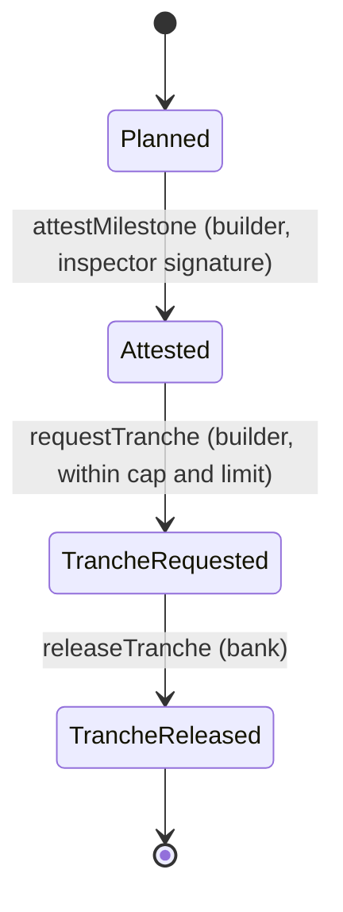

# Architecture

Veridom Milestones has four parties and one contract. Each party keeps its own private state; the contract
holds only what every party may see.

## Parties

| Party | Holds privately | Does on chain |
| --- | --- | --- |
| Bank (lender) | Its secret; the loan terms from the agreement | Deploys, registers inspectors, registers projects, releases tranches |
| Builder | Its secret; terms and salt; running total; per stage the evidence hash, salt, inspector signature, tranche amount and salt | Accepts the project, proves stages, requests tranches, consents to disclosures |
| Inspector | A Jubjub Schnorr key pair | Nothing. Signs off chain after a site visit |
| Auditor | Its key | Nothing. Verifies packets against the ledger |

## One stage, end to end

```mermaid
sequenceDiagram
  autonumber
  participant B as Builder (device)
  participant I as Inspector
  participant C as Contract (public ledger)
  participant K as Bank
  participant A as Auditor

  Note over B,K: Once per loan
  B->>K: Terms + salt, project id, builder key hash (loan agreement, off chain)
  K->>C: registerProject(id, builderKey, termsCommitment, stageCount)
  B->>C: acceptProject(id) [proves: my terms open termsCommitment]

  Note over B,I: Per stage
  B->>I: Evidence bundle: photos, invoices, contractor records (off chain)
  I->>B: Schnorr signature over (contract, project, stage, SHA-256 of bundle)
  B->>C: attestMilestone(id, k) [proves: registered inspector signed this bundle for this stage; signature unspent; stage in order]
  C-->>K: stage k: Attested, inspector #i (no evidence, no amounts)
  B->>C: requestTranche(id, k) [proves: 0 < amount <= cap_k and total + amount <= limit]
  B->>K: amount + salt (off chain)
  K->>K: amountCommitment(amount, salt) == stage k tranche commitment?
  K->>C: releaseTranche(id, k)

  Note over B,A: When an auditor needs one fact
  B->>C: discloseToAuditor(id, k, fact, auditorKey, nonce) [proves: I hold the opening]
  B->>A: Packet: fact value + salt + nonce (off chain)
  A->>C: read ledger
  A->>A: value opens the commitment, and the consent receipt exists
```

## State in the contract

```
lender              Bytes<32>                         lenderKey(bank secret)
inspectors          Map<Uint<16>, JubjubPoint>        the bank's panel
projects            Map<projectId, Project>           builder key hash, terms commitment,
                                                      drawn-total commitment, stage counts
stages              Map<projectId, Map<stage, StageRecord>>
                                                      status, inspector id, evidence commitment,
                                                      tranche commitment
usedAttestations    Set<Bytes<32>>                    nullifiers of spent inspector signatures
disclosureReceipts  Set<Bytes<32>>                    salted consent receipts
attestationCount    Counter
disclosureCount     Counter
```

## Stage state machine



Stages are attested strictly in order (`stage == stagesAttested`). Tranches can be requested for any attested
stage, once.

## Private state

`VeridomPrivateState` in [`contract/src/witnesses.ts`](../contract/src/witnesses.ts):

```ts
{
  secret: Uint8Array,                 // 32 bytes
  projects: {
    [projectIdHex]: {
      terms: { limit, stageCaps[6] }, termsSalt,
      drawnTotal, drawnSalt,
      stages: { [k]: { evidenceHash, evidenceSalt, inspectorId, signature, trancheAmount, trancheSalt? } }
    }
  }
}
```

Witnesses read from it; two write-back witnesses (`storeAcceptance`, `storeDraw`) update it with fresh salts as
part of a call. In midnight-js the update is persisted only after the transaction is accepted; in the simulator
a failed assert leaves it unchanged.

## Frontend

The UI talks to one interface, `MilestonesBackend` ([`ui/src/backend/types.ts`](../ui/src/backend/types.ts)),
with two implementations:

- `SimulatorBackend`: the compiled contract and the official compact-runtime run in the browser tab. No
  network, no proofs; identical circuit logic.
- `LaceBackend`: DApp Connector API 4.0.1 to Lace, `FetchZkConfigProvider` serving the compiler output,
  `httpClientProofProvider` to the proof server Lace is configured with, `indexerPublicDataProvider` for
  reads, and `deployContract` / `findDeployedContract` / `submitCallTx` from midnight-js 4.1.1. Parties are
  separate private-state ids.

Evidence files are hashed with WebCrypto in the browser; only the SHA-256 of the bundle manifest enters a
witness.
